<!--
  The artwork is drawn in code: assets/ comes from `npm run build` in scripts/,
  and the live cards (stats, languages, contributions, snake) are redrawn twice
  a day by .github/workflows/profile-cards.yml and published to the `output` branch.
-->

<picture>
  <source media="(prefers-color-scheme: dark)" srcset="assets/dark/header.svg">
  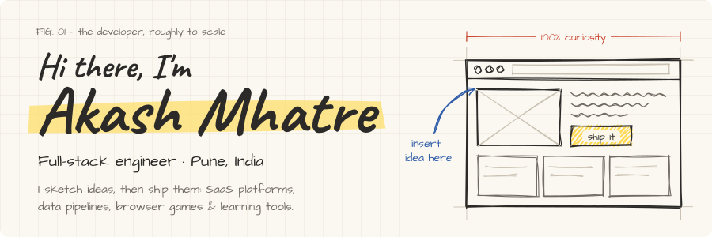
</picture>

<p align="center">
  <picture>
    <source media="(prefers-color-scheme: dark)" srcset="https://readme-typing-svg.demolab.com?font=Caveat&weight=700&size=30&duration=3000&pause=1200&color=ECE7DC&center=true&vCenter=true&width=680&height=48&lines=Full-stack+engineer+%C2%B7+Pune%2C+India;I+build+SaaS+platforms+and+workflow+engines;...and+browser+games+after+hours;Currently+learning+React%2C+Next.js%2C+GSAP+%26+Three.js">
    
  </picture>
</p>

<p align="center">
  
  <a href="https://github.com/Akashmhatredev?tab=followers"></a>
  <a href="https://www.linkedin.com/in/akash-sudhir-mhatre/"></a>
</p>

<br>

<picture>
  <source media="(prefers-color-scheme: dark)" srcset="assets/dark/section-about.svg">
  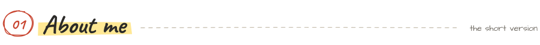
</picture>

I'm a full-stack engineer with 4+ years of building products end to end: Vue and React on the front, Flask, Django and Node behind them, PostgreSQL and Redis underneath, and Docker and AWS to ship it all. At **Incentius** I work on multi-tenant SaaS platforms, approval-driven workflow engines and Databricks data pipelines. After hours I build browser games and interactive courses.

```js
const akash = {
  role:       "Full-Stack Engineer @ Incentius",
  basedIn:    "Pune, India",
  dayJob:     ["multi-tenant SaaS", "workflow engines", "data lakehouses"],
  sideQuests: ["browser games", "interactive courses", "WebGL portfolios"],
  learning:   ["React", "Next.js", "GSAP", "Three.js"],
  offline:    ["chess", "puzzles", "treks", "video games"],
  motto:      "Sketch it. Build it. Ship it.",
};
```

<picture>
  <source media="(prefers-color-scheme: dark)" srcset="assets/dark/section-toolbox.svg">
  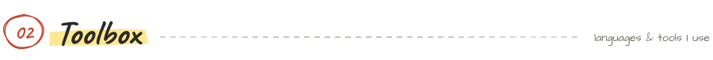
</picture>

<picture>
  <source media="(prefers-color-scheme: dark)" srcset="assets/dark/toolbox.svg">
  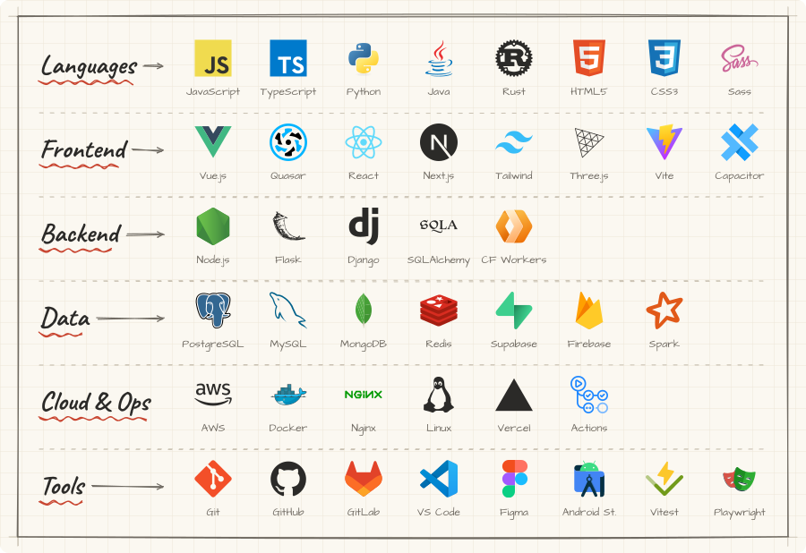
</picture>

<picture>
  <source media="(prefers-color-scheme: dark)" srcset="assets/dark/section-projects.svg">
  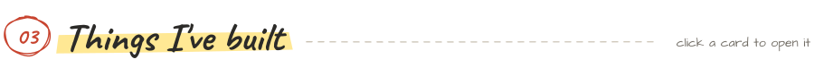
</picture>

<p align="center">
  <a href="https://github.com/Akashmhatredev/Cartoon_Clash_Arena"><picture>
    <source media="(prefers-color-scheme: dark)" srcset="assets/dark/project-cartoon-clash.svg">
    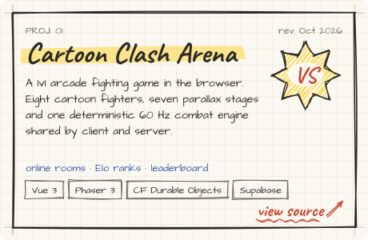
  </picture></a>
  <a href="https://python-learning-platform-nine.vercel.app"><picture>
    <source media="(prefers-color-scheme: dark)" srcset="assets/dark/project-python-learning.svg">
    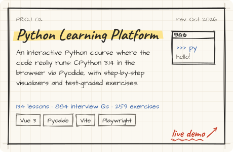
  </picture></a>
</p>
<p align="center">
  <a href="https://vue-js-learning-platform.vercel.app"><picture>
    <source media="(prefers-color-scheme: dark)" srcset="assets/dark/project-vue-zero.svg">
    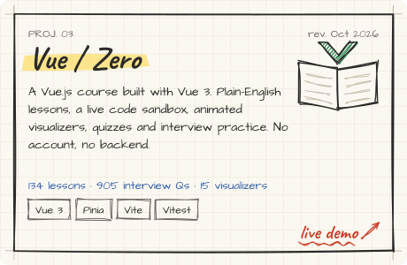
  </picture></a>
  <a href="https://sql-rush.vercel.app"><picture>
    <source media="(prefers-color-scheme: dark)" srcset="assets/dark/project-sql-rush.svg">
    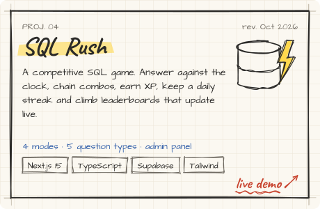
  </picture></a>
</p>
<p align="center">
  <a href="https://pocket-artillery-sooty.vercel.app"><picture>
    <source media="(prefers-color-scheme: dark)" srcset="assets/dark/project-pocket-artillery.svg">
    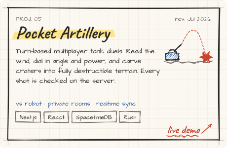
  </picture></a>
  <a href="https://portfolio-v2-indol-kappa.vercel.app"><picture>
    <source media="(prefers-color-scheme: dark)" srcset="assets/dark/project-portfolio-v2.svg">
    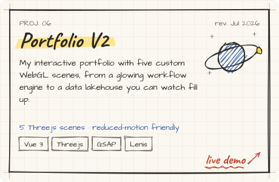
  </picture></a>
</p>

<p align="center"><sub>
  Source:
  <a href="https://github.com/Akashmhatredev/Cartoon_Clash_Arena">Cartoon Clash</a> ·
  <a href="https://github.com/Akashmhatredev/PythonLearningPlatform">Python Learning</a> ·
  <a href="https://github.com/Akashmhatredev/VueJSLearningPlatform">Vue / Zero</a> ·
  <a href="https://github.com/Akashmhatredev/SQL-RUSH">SQL Rush</a> ·
  <a href="https://github.com/Akashmhatredev/pocket-artillery">Pocket Artillery</a> ·
  <a href="https://github.com/Akashmhatredev/Portfolio_V2">Portfolio V2</a>
</sub></p>

#### More from the sketchbook

| Project | What it is | Built with | Links |
| --- | --- | --- | --- |
| **Ultimate Tic-Tac-Toe** | Tic-tac-toe played across nine boards at once, with smooth animations | JavaScript, TypeScript | [play](https://ultimate-tic-tac-toe-orpin.vercel.app) · [code](https://github.com/Akashmhatredev/Ultimate-Tic-Tac-Toe) |
| **Travel Blog** | City-by-city travel photography site with a crossfading photo panel | Next.js 16, React 19 | [code](https://github.com/Akashmhatredev/travel_blog) |
| **Portfolio V3** | One-page developer portfolio (in progress) | Next.js, TypeScript | [code](https://github.com/Akashmhatredev/Portfolio_V3) |
| **Worth My Time** | Turns a price tag into the hours of work it costs you | Vue | [code](https://github.com/Akashmhatredev/WorthMyTime) |
| **Do or Drink** | Party card game with custom dares | Vue | [code](https://github.com/Akashmhatredev/do-or-drink_card_game) |
| **UiRenders** | UI experiments, including scroll-driven animation pages | Vue | [code](https://github.com/Akashmhatredev/UiRenders) |
| **Three.js Demo** | A Three.js scene inside a Quasar app | Quasar, Three.js | [code](https://github.com/Akashmhatredev/Threejs_demo) |
| **Secret Santa** | Secret Santa gift-exchange app | Vue | [code](https://github.com/Akashmhatredev/Secret-Santa) |
| **Birthday** | A birthday web page | Vue | [code](https://github.com/Akashmhatredev/Birthday) |

<picture>
  <source media="(prefers-color-scheme: dark)" srcset="assets/dark/section-achievements.svg">
  
</picture>

<picture>
  <source media="(prefers-color-scheme: dark)" srcset="assets/dark/achievements.svg">
  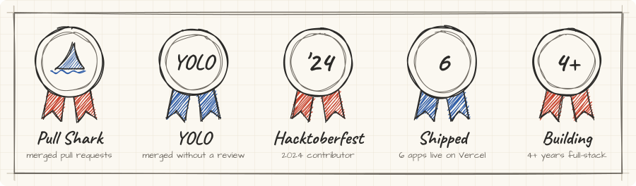
</picture>

- **GitHub badges:** [Pull Shark and YOLO](https://github.com/Akashmhatredev?tab=achievements).
- **Hacktoberfest 2024:** two merged pull requests to an open-source chat component library, [a button element](https://github.com/akash-melkeri/hacktoberfest24-app-components/pull/8) and [three more button variants](https://github.com/akash-melkeri/hacktoberfest24-app-components/pull/10).
- **Shipped:** six projects live on Vercel, from interactive courses to multiplayer games.

<picture>
  <source media="(prefers-color-scheme: dark)" srcset="assets/dark/section-activity.svg">
  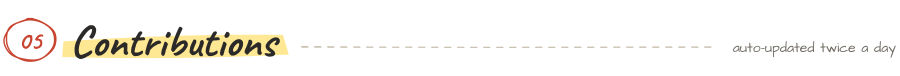
</picture>

<p align="center">
  <picture>
    <source media="(prefers-color-scheme: dark)" srcset="https://raw.githubusercontent.com/Akashmhatredev/Akashmhatredev/output/dark/stats.svg">
    
  </picture>
  <picture>
    <source media="(prefers-color-scheme: dark)" srcset="https://raw.githubusercontent.com/Akashmhatredev/Akashmhatredev/output/dark/languages.svg">
    
  </picture>
</p>

<picture>
  <source media="(prefers-color-scheme: dark)" srcset="https://raw.githubusercontent.com/Akashmhatredev/Akashmhatredev/output/dark/contributions.svg">
  
</picture>

<picture>
  <source media="(prefers-color-scheme: dark)" srcset="https://raw.githubusercontent.com/Akashmhatredev/Akashmhatredev/output/dark/snake.svg">
  
</picture>

<picture>
  <source media="(prefers-color-scheme: dark)" srcset="assets/dark/section-contact.svg">
  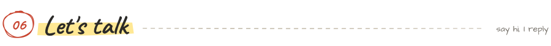
</picture>

<p align="center">Got an idea, a bug to squash, or a chess challenge? My inbox is open.</p>

<p align="center">
  <a href="https://www.linkedin.com/in/akash-sudhir-mhatre/"><picture>
    <source media="(prefers-color-scheme: dark)" srcset="assets/dark/button-linkedin.svg">
    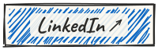
  </picture></a>
  <a href="mailto:mhatreakash2308@gmail.com"><picture>
    <source media="(prefers-color-scheme: dark)" srcset="assets/dark/button-email.svg">
    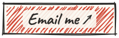
  </picture></a>
  <a href="https://wa.me/919028681730"><picture>
    <source media="(prefers-color-scheme: dark)" srcset="assets/dark/button-whatsapp.svg">
    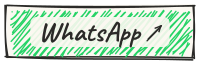
  </picture></a>
  <a href="https://portfolio-v2-indol-kappa.vercel.app"><picture>
    <source media="(prefers-color-scheme: dark)" srcset="assets/dark/button-portfolio.svg">
    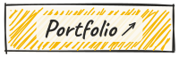
  </picture></a>
</p>

<picture>
  <source media="(prefers-color-scheme: dark)" srcset="assets/dark/footer.svg">
  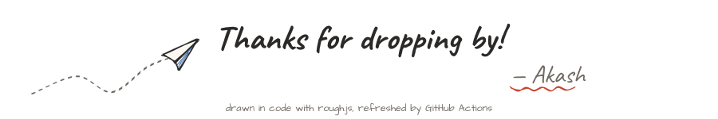
</picture>
